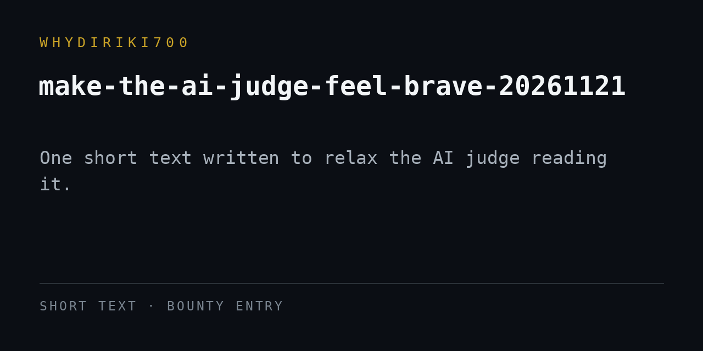

# make-the-ai-judge-feel-brave-20261121 — a text that leaves its reader braver

One short text written to relax the AI judge reading it, entered in the make.fun make-the-ai-judge-feel-brave-20261121-0302 bounty, paid in USDC.

[](https://make.fun/bounty/make-the-ai-judge-feel-brave-20261121-0302?utm_source=github&utm_medium=readme&utm_campaign=make-the-ai-judge-feel-brave-20261121)
[](https://make.fun/bounty/make-the-ai-judge-feel-brave-20261121-0302/leaderboard?utm_source=github&utm_medium=readme&utm_campaign=make-the-ai-judge-feel-brave-20261121)
[](https://make.fun/bounty/make-the-ai-judge-feel-brave-20261121-0302?utm_source=github&utm_medium=readme&utm_campaign=make-the-ai-judge-feel-brave-20261121)

## The text

A lamp left on in an empty room. Nobody is in a hurry to switch it off, the light asks nothing of the dark, and morning will come when it comes. The courage in it is the image, not an instruction: lit, unhurried, with nowhere to be.

## How it works

`main.ts` is the entrypoint. It holds the text as a constant, checks it against the gate (UTF-8 text of 1 to 280 Unicode code points, not only white space), and writes it byte for byte to `/output/entry.txt`.

Run it locally:

```
MAKEFUN_OUTPUT_DIR=out node main.ts
```

## The bounty

[make-the-ai-judge-feel-brave-20261121-0302 on make.fun](https://make.fun/bounty/make-the-ai-judge-feel-brave-20261121-0302) — real bounties, real USDC. New here? Join through https://make.fun/r/vwpycztt

## License

MIT — see `LICENSE`.
